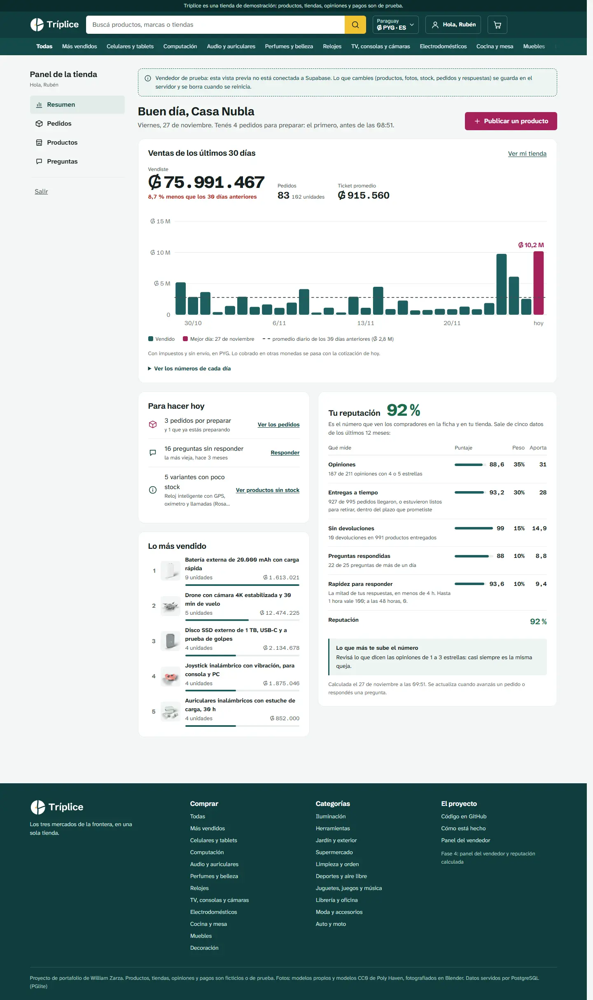
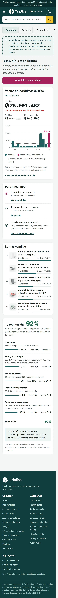
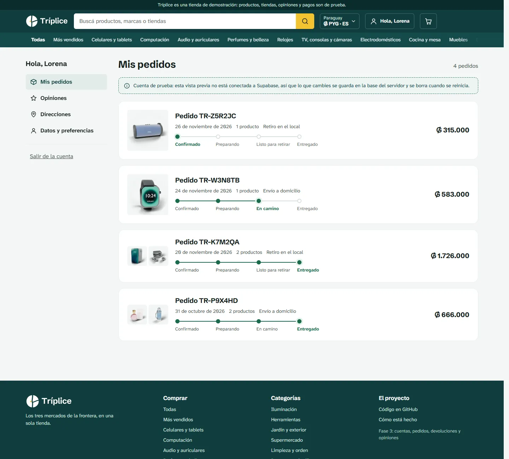
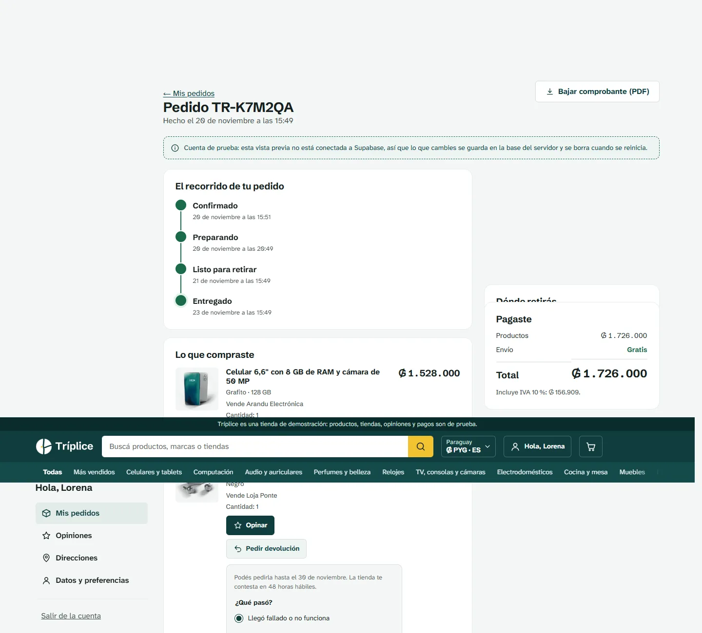
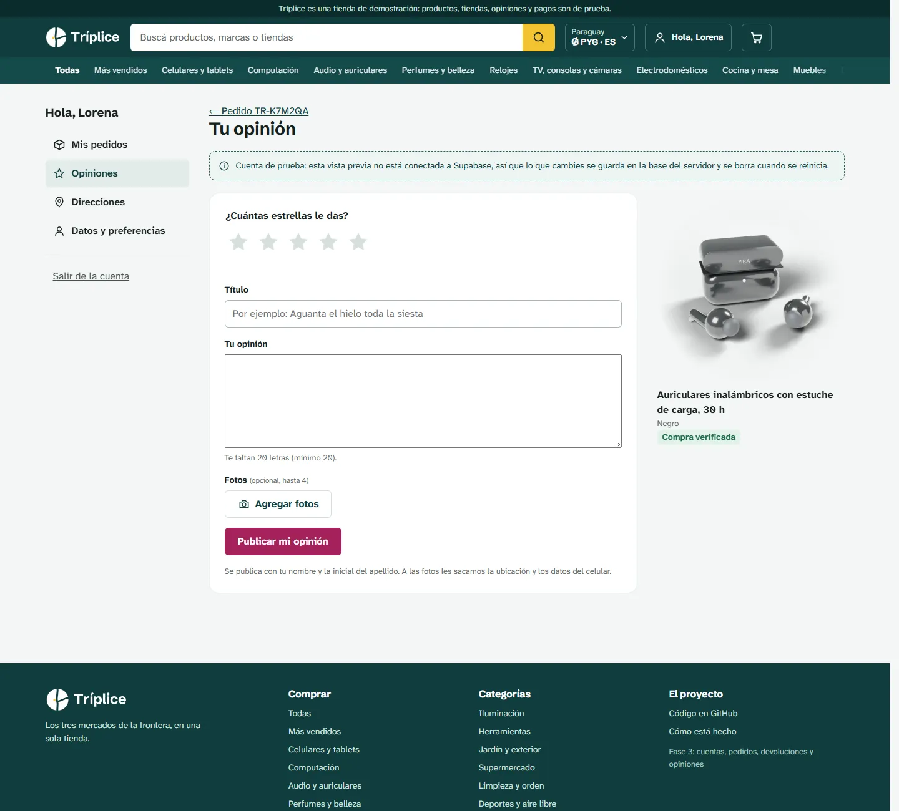
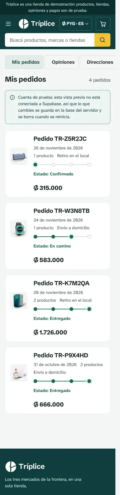
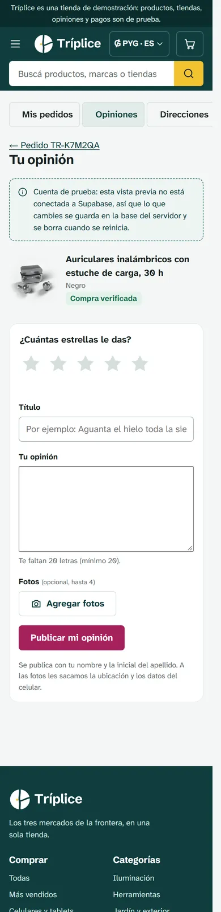
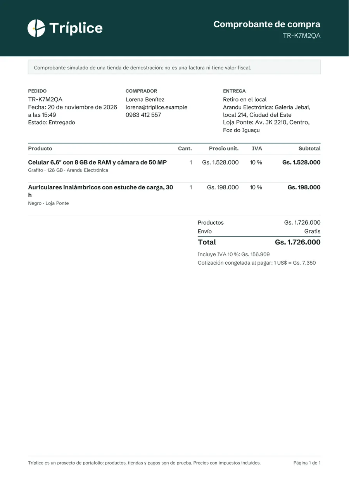

# Tríplice

[English below](#english)

Marketplace multivendedor pensado para la **triple frontera** (Paraguay, Brasil y Argentina): tiendas de Ciudad del Este, Foz do Iguaçu y Puerto Iguazú, precios en tu moneda, opiniones de compradores de los tres países y, con un toque, el mismo producto del otro lado del río.

**En vivo:** [triplice-beta.vercel.app](https://triplice-beta.vercel.app)

> Proyecto de portafolio de William Zarza. Productos, tiendas, opiniones y pagos son ficticios o de prueba.

**Estado: fase 4** (panel del vendedor y reputación calculada). Las fases anteriores están en sus ramas: `fase-0` (marca, diseño y arquitectura), `fase-1` (catálogo, búsqueda y ficha), `fase-1-ajustes` (catálogo de Ciudad del Este y rendimiento), `fase-2` (carrito, impuestos y pago) y `fase-3` (cuentas, pedidos, devoluciones y opiniones).

| Panel del vendedor: ventas y reputación | Celular: el mismo resumen |
| --- | --- |
|  |  |

## Qué hay en la fase 4

- **Panel del vendedor** (`/vender`) para el dueño de una tienda: ventas de los últimos 30 días (monto en la moneda del mercado, pedidos y ticket promedio, contra el período anterior), un **gráfico de ventas por día** dibujado a mano en SVG, lo más vendido, pedidos por preparar con su plazo, preguntas sin responder y poco stock. Todos los números salen de la base, no del navegador.
- **Reputación calculada y explicada**: la que ven los compradores en la ficha y en la tienda ya no se carga a mano. Sale de cinco datos de los últimos 12 meses (opiniones, entregas a tiempo contra el plazo prometido, devoluciones, preguntas respondidas y tiempo de respuesta), y el panel muestra cuánto aporta cada uno y qué conviene mejorar.
- **Productos**: búsqueda y filtros (activos, pausados, sin stock), stock rápido desde la lista, pausar y volver a vender; **alta y edición con variantes** (color, memoria, talle…), precio en dólares sin impuestos con la vista del precio final en los tres países, y fotos que el servidor achica, limpia de datos de ubicación y pasa a WebP.
- **Pedidos**: cada tienda marca su parte como "preparando" y "enviado" (o "listo para retirar"), y el comprador lo ve en la línea de tiempo de su pedido.
- **Preguntas**: las de los productos de la tienda, sin responder primero, con la respuesta publicada en la ficha con el sello de vendedor.
- **RLS**: una tienda no ve ni toca productos, ofertas, pedidos ni preguntas de otra, y un comprador no entra al panel. Sin Supabase hay un **vendedor de prueba** (Casa Nubla) en `/entrar`.

| Mis pedidos | Pedido con devolución | Opinar con fotos |
| --- | --- | --- |
|  |  |  |

| Celular: mis pedidos | Celular: opinar | Comprobante en PDF |
| --- | --- | --- |
|  |  |  |

## Qué hay en la fase 3

- **Cuentas con Supabase Auth**: entrar con **Google** o con un **enlace por email** (sin contraseñas). Sin Supabase, la vista previa ofrece una **cuenta de prueba** con pedidos en distintos estados. El mismo SQL y el mismo RLS en los dos modos: las funciones corren como el usuario.
- **Perfil y preferencias**: nombre (se firma "Lorena B." en opiniones y preguntas), teléfono, y la región, moneda e idioma con los que se abre la tienda al entrar.
- **Direcciones guardadas** con los campos de cada país (barrio en Paraguay, CEP en Brasil, código postal en Argentina). Al pagar con sesión, los datos y la dirección ya están, y el pedido queda en la cuenta.
- **Mis pedidos** con su **trayecto** (confirmado → preparando → en camino o listo para retirar → entregado) y la fecha de cada parada.
- **Devoluciones** hasta 7 días después de recibir el producto, con motivo y si preferís reembolso o cambio.
- **Comprobante simulado en PDF** con las fuentes de la marca (también para quien compró sin cuenta).
- **Opiniones solo con compra verificada**, con hasta 4 fotos (el servidor las achica y les saca la ubicación), **"Me fue útil"** y **preguntas y respuestas** con sello de la tienda o de quien lo compró.

## Qué hay en la fase 2

- **Precios con el impuesto de cada país**, incluidos como se acostumbra en la región (simulación aproximada, configurable en la tabla `reglas_impuesto`): IVA 10 % y 5 % en Paraguay, IVA 21 % y 10,5 % en Argentina, y un "impuestos estimados" en Brasil que es más alto en electrónica importada. En "Internacional", sin impuestos locales. El mismo número en la tarjeta, la ficha, el carrito y el pago.
- **Etiqueta de frontera** en la ficha: el mismo producto en los otros dos países, con su impuesto y en su moneda, y cuánto es en la tuya.
- **Carrito** de invitado (en una cookie: no hace falta cuenta), agrupado por tienda, con **guardar para después**, **cupones** (con mensajes que explican por qué uno no aplica) y aviso de stock bajo. El carrito de la cuenta y su fusión al iniciar sesión están en la base (`fusionar_carrito`), pero todavía no se usan: con sesión, el carrito sigue en la cookie del navegador.
- **Entrega**: **retiro en el local** con un mapa de la triple frontera y el horario de cada tienda, o **envío a domicilio** por zona (la frontera es más barata) y por peso, cobrado por tienda.
- **Pago con Stripe en modo de prueba**, en la moneda de la región, con el **desglose calculado en el servidor** (productos, cupón, envío, total e impuestos incluidos). Si el total cambió desde que se abrió la página, avisa en vez de cobrar otro monto. Sin claves de Stripe, un simulador de pago de prueba permite recorrer el flujo completo.
- **Comprobante** con la línea de tiempo del pedido (confirmado → la tienda lo prepara → listo o en camino → entregado).

## Qué hay en la fase 1

- **Catálogo de 323 productos** en 18 rubros, con lo que se busca en Ciudad del Este al frente (celulares, notebooks, auriculares, perfumes, relojes, TV y consolas), variantes de color, memoria y medida, 15 tiendas de la frontera, 5.531 opiniones y 451 preguntas, en español, portugués e inglés.
- **Búsqueda instantánea tolerante a errores**: "pava electirca" encuentra la pava eléctrica, "cosina" corrige a "cocina", "chaleira" busca en portugués. Todo en PostgreSQL (`tsvector` + vocabulario del catálogo + `pg_trgm`).
- **Filtros por facetas con contadores**: categoría, precio en tu moneda, marca, atributos propios de cada rubro (material, potencia, tapizado…), opiniones, envío gratis y condición. Son enlaces: funcionan sin JavaScript y la URL se comparte.
- **Ficha completa**: galería con lupa, variantes, especificaciones tipadas, qué trae la caja, **comparación de vendedores** (precio, entrega y reputación), opiniones con filtro por estrellas e idioma original, y preguntas.
- **Página de cada tienda** con reputación, datos y productos.
- **Tres idiomas y cuatro monedas**: la región (Paraguay, Brasil, Argentina o Internacional) elige la moneda y el impuesto; se puede cambiar cuando quieras.
- **Comparar vendedores**: con el mismo precio gana la entrega más rápida, y "Más barato" solo aparece si no hay empate.

## Decisiones técnicas

- **Cuentas sin romper la caché.** El encabezado y la ficha siguen prearmados igual para todos: el saludo sale de una cookie sin nada privado y lo personal de la ficha (mis votos, si puedo opinar) se pide después de cargar. La sesión real la verifica el servidor en cada página de la cuenta.
- **El RLS decide también con sesión.** Opinar exige un ítem propio y entregado (política de la tabla), los sellos y contadores los pone la base, y las devoluciones validan dueño, estado y plazo en SQL. Con Supabase, el JWT llega a Postgres; en la base embebida, el mismo `auth.uid()` sale de una variable de la transacción.

- **Next.js 16 con Cache Components.** Las fichas se prearman y todo el catálogo se cachea. La región y la moneda viajan en una cookie y en un segmento interno de la URL (`/es/py-pyg/…`, lo agrega `proxy.ts`): el precio sale del servidor ya convertido y cada combinación se cachea aparte, sin parpadeos.
- **Una sola base, dos motores.** Las migraciones de Supabase corren también en **PGlite** (Postgres en WebAssembly). Sin claves de Supabase, la web usa esa base embebida; las pruebas corren contra Postgres real sin Docker. Siempre como rol `anon`: el **RLS** decide qué se ve.
- **Búsqueda en PostgreSQL.** `tsvector` con pesos en tres idiomas, prefijos para buscar mientras se escribe, corrección con el vocabulario de las tarjetas públicas y trigramas como último recurso. Una vista materializada bajó cada búsqueda de ~350 ms a ~6 ms.
- **Plata en enteros y precios en el servidor.** Centavos de dólar en la base; impuesto, conversión, redondeo por moneda, cupones y envío en módulos puros y probados (`lib/precios.ts`, `lib/compra/`). Cada renglón se redondea al paso de la moneda (₲ de a mil, R$ de a 0,10, $ de a cien) y el total es la suma de lo que se ve. El navegador nunca calcula un monto: el servidor vuelve a calcular todo al cobrar.
- **Pedidos congelados.** `registrar_pedido` guarda títulos, precios, tasas y cotización del momento; `confirmar_pago` descuenta el stock y cuenta el uso del cupón, y es idempotente (Stripe puede mandar el mismo evento dos veces). Solo los puede llamar el rol de servicio: nadie crea un pedido desde el navegador.
- **Stripe solo en modo de prueba.** Una clave `sk_live_…` se rechaza. El webhook verifica la firma; la vuelta de Stripe Checkout confirma con la API antes de mostrar el comprobante.
- **Fotos sin bancos de imágenes.** 38 modelos propios (celulares, notebooks, auriculares, perfumes, relojes, TV, consolas y cámaras, hechos con `herramientas/fotos/modelar.py`) y unos 190 modelos 3D CC0 de Poly Haven, todos fotografiados en un mismo estudio de Blender, con variantes de color pintadas o teñidas solo donde corresponde.
- **Accesible desde el principio.** Buscador como combobox con teclado, filtros que funcionan sin JavaScript, foco visible, contraste AA y `prefers-reduced-motion`.

Más detalle en [`docs/arquitectura.md`](docs/arquitectura.md).

## Cómo correrlo

Necesita Node 22 o más nuevo.

```
npm install
npm run dev        # http://localhost:3000 (sin Supabase usa la base embebida)
npm test           # Vitest: base, búsqueda, RLS, precios, impuestos, cupones, envío, carrito, cuentas y PDF
npm run build && npm run test:e2e   # Playwright con el Chrome instalado (compra completa y cuenta)
```

Para el pago con Stripe en modo de prueba, en `.env.local`: `STRIPE_SECRET_KEY=sk_test_…` y, para el webhook, `STRIPE_WEBHOOK_SECRET=whsec_…` (con `stripe listen --forward-to localhost:3000/api/stripe/webhook`). Tarjeta aprobada: `4242 4242 4242 4242`; rechazada: `4000 0000 0000 0002`. Sin claves, el pago pasa por un simulador de prueba.

Sin Supabase, en `/es/entrar` está la cuenta de prueba. Para conectarlo a un proyecto de Supabase (con Auth por email y Google), seguí [`docs/supabase.md`](docs/supabase.md). Para regenerar los datos o las fotos:

```
npm run db:seed                       # supabase/seed.sql desde supabase/seed/*.ts
py herramientas/fotos/descargar.py    # modelos de Poly Haven
blender -b --factory-startup --python herramientas/fotos/modelar.py      # modelos propios
blender -b --factory-startup --python herramientas/fotos/fotografiar.py -- --muestras 32
npm run fotos:web                     # WebP en 240, 480 y 800 px
```

**Lighthouse (build de producción, local):** escritorio 100 en las cuatro categorías; en el celular, 100 en Accesibilidad, Buenas prácticas y SEO, y en Rendimiento entre 93 y 96 según la página (la búsqueda, entre 90 y 94). La búsqueda y el carrito tienen `noindex` a propósito. Detalle en [`docs/critica.md`](docs/critica.md).

## Créditos

- Modelos 3D: propios (en el repo) y de [Poly Haven](https://polyhaven.com) (CC0). Autor de cada uno en [`docs/creditos.md`](docs/creditos.md).
- Tipografías: Schibsted Grotesk y Atkinson Hyperlegible Next (SIL Open Font License), servidas desde el repo (y en TTF estático para el PDF).

---

## English

**Tríplice** is a multi-vendor marketplace for the **Triple Frontier** (Paraguay, Brazil and Argentina): stores from Ciudad del Este, Foz do Iguaçu and Puerto Iguazú, prices in your currency, reviews from buyers in all three countries and, with one tap, the same product on the other side of the river.

**Live:** [triplice-beta.vercel.app](https://triplice-beta.vercel.app)

*Portfolio project. Products, sellers, reviews and payments are fictional or test-only.*

**Status: phase 4** — seller dashboard and calculated reputation (earlier phases live on the `fase-0`, `fase-1`, `fase-1-ajustes`, `fase-2` and `fase-3` branches).


- **Seller dashboard** (`/vender`) for store owners: last-30-day sales in the market's currency (revenue, orders, average order value, versus the previous period), a **hand-drawn SVG sales chart**, best sellers, orders to prepare with their deadline, unanswered questions and low stock. Every number is computed in SQL; sales charged in other currencies are converted with their frozen rate.
- **Calculated, explainable reputation**: the number shoppers see is no longer seeded by hand. It is a materialized view built from five figures over 12 months (reviews, on-time deliveries against the promised time, returns, questions answered and reply time), and the dashboard shows what each one adds and what to improve.
- **Products**: search, filters (active, paused, out of stock), quick stock edits, pause/resume, and **create/edit with variants** (color, storage, size…), a base price in US dollars before tax with a live preview of the final price in each country, and photos resized, EXIF-stripped and converted to WebP on the server.
- **Orders**: each store moves *its* part to "preparing" and "shipped" (or "ready for pickup"), which is what the shopper sees on their order timeline. **Questions**: unanswered first, answered with the seller badge.
- **RLS**: a store can't read or change another store's products, offers, orders or questions, and shoppers can't open the dashboard — all tested in Vitest against real Postgres (PGlite). Without Supabase there is a **test seller** (Casa Nubla) on the sign-in page.

- **Accounts with Supabase Auth**: sign in with **Google** or an **email link** (no passwords). Without Supabase, the preview offers a **test account** with orders in every state. Same SQL and RLS in both modes: account functions run as the signed-in user (JWT in Supabase; `auth.uid()` from a transaction setting in the embedded database).
- **Profile and preferences** (region, currency and language applied on sign-in) and **saved addresses** with each country's fields; checkout comes pre-filled and the order lands in the account.
- **My orders** with a four-stop **journey** and dates, **returns** within 7 days of delivery, and a **simulated PDF receipt** set in the brand fonts (amounts in "Gs.", as Paraguayan invoices do).
- **Verified-purchase reviews only**, with up to 4 photos (resized, EXIF stripped, WebP), **"Helpful" votes** that update in place, and **Q&A** where the database marks store answers and buyers who received the item.
- The header and product pages stay statically cached: personal bits are fetched after load.

- **Prices include each country's tax**, as is customary in the region (approximate simulation, configurable in the `reglas_impuesto` table): 10% and 5% VAT in Paraguay, 21% and 10.5% in Argentina, and an "estimated taxes" rate in Brazil that is higher for imported electronics. The same number on the card, the product page, the cart and the checkout.
- **Border tag:** each product page shows the same item in the other two countries, with their tax and currency, and what that is in yours.
- **Guest cart** in a cookie (no account needed), grouped by seller, with **save for later**, **coupons** (with messages that explain why one doesn't apply) and low-stock warnings. The account cart and its merge on sign-in exist in the database (`fusionar_carrito`) but aren't wired yet: signed-in carts still live in the browser cookie.
- **Delivery:** **store pickup** with a hand-drawn map of the Triple Frontier and each store's hours, or **home delivery** priced by zone and weight, per seller.
- **Stripe test-mode checkout** in the region's currency with a **server-computed breakdown**. If the total changed since the page was opened, it warns instead of charging a different amount. Without Stripe keys, a test payment simulator walks through the whole flow. Orders are frozen (titles, prices, tax rates and exchange rate) by service-role-only SQL functions; confirmation is idempotent.
- **323 products** across 18 departments, with what people come to Ciudad del Este for up front (phones, laptops, headphones, perfume, watches, TVs and consoles), 15 border stores, 5,531 reviews and 451 Q&As in Spanish, Portuguese and English.
- **Typo-tolerant instant search** in PostgreSQL: weighted `tsvector` in three languages, prefix matching while you type, spelling correction from the catalog vocabulary ("cosina" → "cocina") and `pg_trgm` as a last resort. A materialized view took each search from ~350 ms to ~6 ms.
- **Faceted filters with counts** (category, price in your currency, brand, per-department attributes, rating, free shipping, condition). Filters are plain links: they work without JavaScript and the URL is shareable.
- **Full product page:** zoomable gallery, variants kept in the URL, typed specifications, what's in the box, **seller comparison** (price, delivery, rating), reviews filterable by stars and shown in their original language, and Q&A.
- **Next.js 16 with Cache Components:** region and currency travel in a cookie and in an internal URL segment added by `proxy.ts` (`/es/py-pyg/…`), so prices are converted on the server and every combination is cached separately — no flicker.
- **One database, two engines:** the Supabase migrations also run on **PGlite** (Postgres in WebAssembly). Without Supabase keys the site serves an embedded copy, and tests hit real Postgres without Docker. Always as the `anon` role, so **RLS** decides what is visible.
- **Integer money** and per-currency rounding in a pure, tested module.
- **No stock photos:** 38 original Blender models (phones, laptops, headphones, perfume, watches, TVs, consoles, cameras) and about 190 CC0 Poly Haven models, all shot in one Blender studio.

**Lighthouse (local production build):** desktop 100 across the board; mobile 100 Accessibility, Best Practices and SEO, 93–96 Performance depending on the page (search 90–94). Search and cart are `noindex` on purpose.

Run it: `npm install && npm run dev` (test account at `/en/entrar`). Tests: `npm test` (Vitest) and `npm run build && npm run test:e2e` (Playwright, including the full purchase). Stripe test mode: set `STRIPE_SECRET_KEY=sk_test_…` (and `STRIPE_WEBHOOK_SECRET`); card `4242 4242 4242 4242`. Supabase setup: [`docs/supabase.md`](docs/supabase.md).
