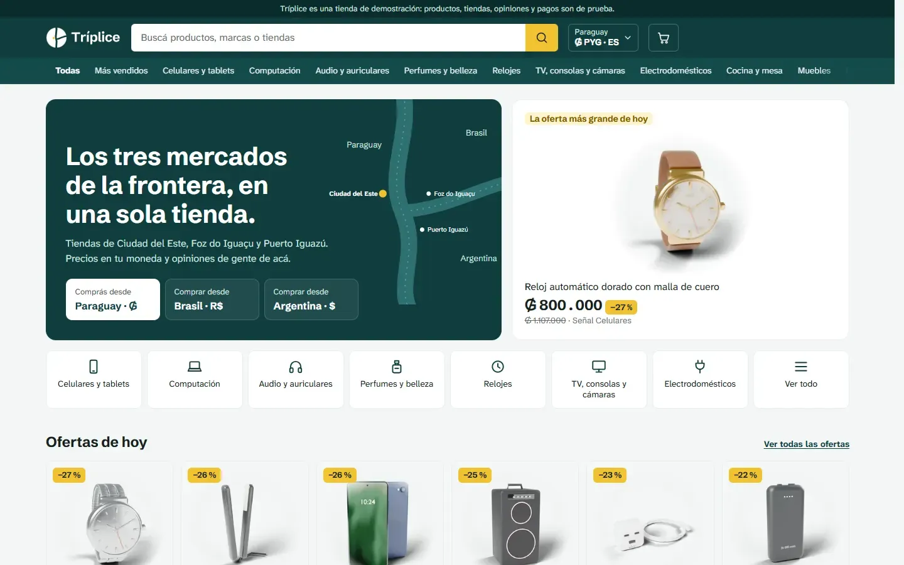
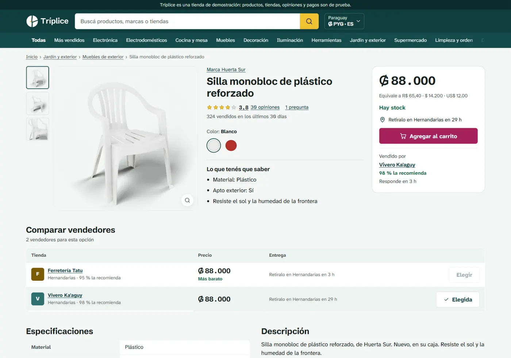
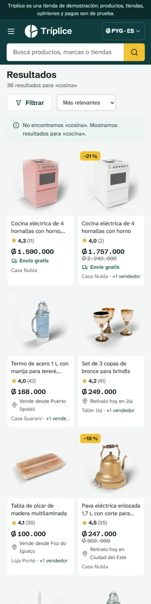

# Tríplice

[English below](#english)

Marketplace multivendedor pensado para la **triple frontera** (Paraguay, Brasil y Argentina): tiendas de Ciudad del Este, Foz do Iguaçu y Puerto Iguazú, precios en tu moneda, opiniones de compradores de los tres países y, con un toque, el mismo producto del otro lado del río.

> Proyecto de portafolio de William Zarza. Productos, tiendas, opiniones y pagos son ficticios o de prueba.

**Estado: fase 1** (catálogo, búsqueda y ficha de producto). La fase 0 (marca, sistema de diseño, maquetas y arquitectura) está en la rama `fase-0`.



| Ficha de producto | Búsqueda en el celular |
| --- | --- |
|  |  |

## Qué hay en la fase 1

- **Catálogo de 365 productos** en 15 rubros, con variantes de color y medida, 15 tiendas de la frontera, 6.395 opiniones y 482 preguntas, en español, portugués e inglés.
- **Búsqueda instantánea tolerante a errores**: "pava electirca" encuentra la pava eléctrica, "cosina" corrige a "cocina", "chaleira" busca en portugués. Todo en PostgreSQL (`tsvector` + vocabulario del catálogo + `pg_trgm`).
- **Filtros por facetas con contadores**: categoría, precio en tu moneda, marca, atributos propios de cada rubro (material, potencia, tapizado…), opiniones, envío gratis y condición. Son enlaces: funcionan sin JavaScript y la URL se comparte.
- **Ficha completa**: galería con lupa, variantes, especificaciones tipadas, qué trae la caja, **comparación de vendedores** (precio, entrega y reputación), opiniones con filtro por estrellas e idioma original, y preguntas.
- **Página de cada tienda** con reputación, datos y productos.
- **Tres idiomas y cuatro monedas**: la región (Paraguay, Brasil, Argentina o Internacional) elige la moneda; se puede cambiar cuando quieras. Por ahora sin impuestos: llegan en la fase 2.

## Decisiones técnicas

- **Next.js 16 con Cache Components.** Las fichas se prearman y todo el catálogo se cachea. La región y la moneda viajan en una cookie y en un segmento interno de la URL (`/es/py-pyg/…`, lo agrega `proxy.ts`): el precio sale del servidor ya convertido y cada combinación se cachea aparte, sin parpadeos.
- **Una sola base, dos motores.** Las migraciones de Supabase corren también en **PGlite** (Postgres en WebAssembly). Sin claves de Supabase, la web usa esa base embebida; las pruebas corren contra Postgres real sin Docker. Siempre como rol `anon`: el **RLS** decide qué se ve.
- **Búsqueda en PostgreSQL.** `tsvector` con pesos en tres idiomas, prefijos para buscar mientras se escribe, corrección con el vocabulario de las tarjetas públicas y trigramas como último recurso. Una vista materializada bajó cada búsqueda de ~350 ms a ~6 ms.
- **Plata en enteros.** Centavos de dólar en la base; conversión y redondeo por moneda en un módulo puro (`lib/precios.ts`): ₲ de a mil, R$ de a 0,10 y $ de a cien.
- **Fotos sin bancos de imágenes.** 228 modelos 3D CC0 de Poly Haven fotografiados en un mismo estudio de Blender, con variantes de color teñidas solo donde corresponde (una máscara por tono y saturación: se pinta la tela del sillón, no la madera).
- **Accesible desde el principio.** Buscador como combobox con teclado, filtros que funcionan sin JavaScript, foco visible, contraste AA y `prefers-reduced-motion`.

Más detalle en [`docs/arquitectura.md`](docs/arquitectura.md).

## Cómo correrlo

Necesita Node 22 o más nuevo.

```
npm install
npm run dev        # http://localhost:3000 (sin Supabase usa la base embebida)
npm test           # Vitest: base, búsqueda, RLS, precios
npm run build && npm run test:e2e   # Playwright con el Chrome instalado
```

Para conectarlo a un proyecto de Supabase, seguí [`docs/supabase.md`](docs/supabase.md). Para regenerar los datos o las fotos:

```
npm run db:seed                       # supabase/seed.sql desde supabase/seed/*.ts
py herramientas/fotos/descargar.py    # modelos de Poly Haven
blender -b --factory-startup --python herramientas/fotos/fotografiar.py -- --muestras 32
npm run fotos:web                     # WebP en 240, 480 y 800 px
```

**Lighthouse (build de producción, local):** ver la tabla en `docs/critica.md`.

## Créditos

- Modelos 3D: [Poly Haven](https://polyhaven.com) (CC0). Autor de cada uno en [`docs/creditos.md`](docs/creditos.md).
- Tipografías: Schibsted Grotesk y Atkinson Hyperlegible Next (SIL Open Font License), servidas desde el repo.

---

## English

**Tríplice** is a multi-vendor marketplace for the **Triple Frontier** (Paraguay, Brazil and Argentina): stores from Ciudad del Este, Foz do Iguaçu and Puerto Iguazú, prices in your currency, reviews from buyers in all three countries and, with one tap, the same product on the other side of the river.

*Portfolio project. Products, sellers, reviews and payments are fictional or test-only.*

**Status: phase 1** — catalog, search and product page (phase 0, with brand, design system, mockups and architecture, lives on the `fase-0` branch).

- **365 products** across 15 departments with color and size variants, 15 border stores, 6,395 reviews and 482 Q&As in Spanish, Portuguese and English.
- **Typo-tolerant instant search** in PostgreSQL: weighted `tsvector` in three languages, prefix matching while you type, spelling correction from the catalog vocabulary ("cosina" → "cocina") and `pg_trgm` as a last resort. A materialized view took each search from ~350 ms to ~6 ms.
- **Faceted filters with counts** (category, price in your currency, brand, per-department attributes, rating, free shipping, condition). Filters are plain links: they work without JavaScript and the URL is shareable.
- **Full product page:** zoomable gallery, variants kept in the URL, typed specifications, what's in the box, **seller comparison** (price, delivery, rating), reviews filterable by stars and shown in their original language, and Q&A.
- **Next.js 16 with Cache Components:** region and currency travel in a cookie and in an internal URL segment added by `proxy.ts` (`/es/py-pyg/…`), so prices are converted on the server and every combination is cached separately — no flicker.
- **One database, two engines:** the Supabase migrations also run on **PGlite** (Postgres in WebAssembly). Without Supabase keys the site serves an embedded copy, and tests hit real Postgres without Docker. Always as the `anon` role, so **RLS** decides what is visible.
- **Integer money** and per-currency rounding in a pure, tested module.
- **No stock photos:** 228 CC0 Poly Haven 3D models shot in one Blender studio, with color variants tinted only where it makes sense (a hue/saturation mask paints the upholstery, not the wood).

Run it: `npm install && npm run dev`. Tests: `npm test` (Vitest) and `npm run build && npm run test:e2e` (Playwright). Supabase setup: [`docs/supabase.md`](docs/supabase.md).
