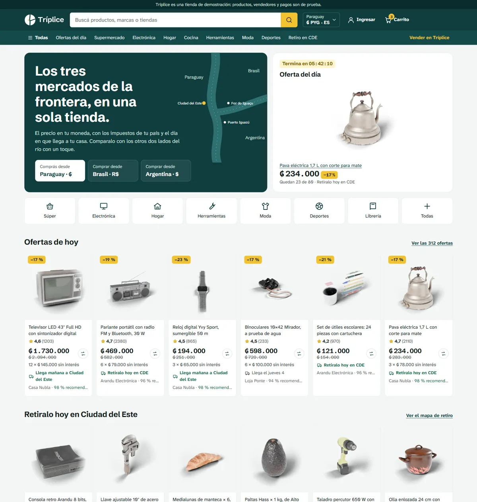
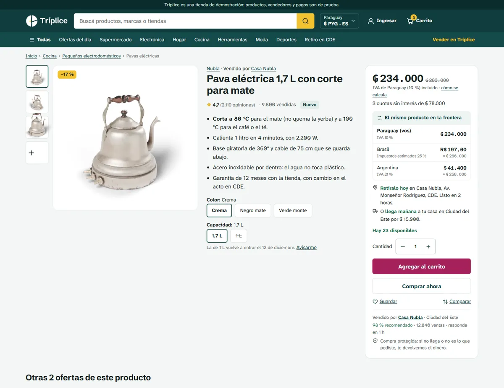
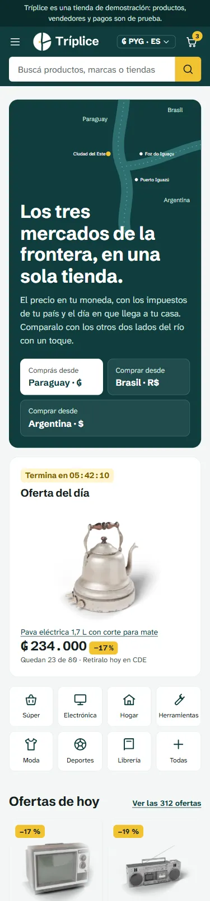

# Tríplice

[English below](#english)

Marketplace multivendedor pensado para la **triple frontera** (Paraguay, Brasil y Argentina): el precio en tu moneda, con los impuestos de tu país y el día en que llega, y con un toque, el mismo producto del otro lado del río.

> Proyecto de portafolio de William Zarza. Productos, vendedores, reseñas y pagos son ficticios o de prueba.

**Estado: fase 0** (marca, sistema de diseño, maquetas y arquitectura). Todavía no hay sitio programado: la fase 1 arranca después de revisar este diseño.



| Ficha de producto | Celular |
| --- | --- |
|  |  |

## Qué hay en la fase 0

| | |
| --- | --- |
| [`docs/marca.md`](docs/marca.md) | Nombre, concepto, logo, favicon y tono de voz en español, portugués e inglés |
| [`docs/diseno.md`](docs/diseno.md) | Paleta con contrastes medidos, tipografías, escala, espacios, radios, sombras, íconos, estados y la tarjeta de producto |
| [`tokens/`](tokens/) | Los tokens en CSS y el nombre de la marca en una constante |
| [`maquetas/`](maquetas/) | Siete páginas navegables con datos de ejemplo: inicio, búsqueda, ficha, carrito, checkout, tienda y panel del vendedor. Se abren con doble clic en `maquetas/index.html` |
| [`docs/arquitectura.md`](docs/arquitectura.md) | Modelo de datos, búsqueda, políticas RLS, cálculo de precio, moneda e impuestos con ejemplos numéricos, carpetas y plan de pruebas |
| [`docs/critica.md`](docs/critica.md) | Comparación honesta contra Amazon y Mercado Libre: en qué es mejor y en qué todavía no |

## Decisiones

- **Una idea fuerte: la etiqueta de frontera.** Cada precio tiene un botón ⇄ que muestra el precio final del mismo producto en los otros dos países, con su impuesto. En la ficha es una tabla con la equivalencia en tu moneda. Es lo que ningún marketplace grande hace y lo que en CDE se hace a mano todos los días.
- **Agua del Paraná + lapacho + ipê.** Verde agua para la marca, magenta lapacho para comprar y amarillo ipê solo para ofertas (si todo es amarillo, nada es oferta, y además es el color de Mercado Libre).
- **Schibsted Grotesk + Atkinson Hyperlegible Next.** Personalidad para títulos y precios; legibilidad máxima para fichas técnicas y formularios. Los importes van siempre en Schibsted (Atkinson tiene el cero con barra).
- **Fotos de producto sin bancos de imágenes:** 20 modelos 3D CC0 de Poly Haven fotografiados en un mismo estudio de Blender ([`herramientas/fotos/fotografiar.py`](herramientas/fotos/fotografiar.py)), con la misma luz y el mismo ángulo. Así la grilla se ve curada.
- **Maquetas sin framework:** HTML, CSS sobre los tokens y un JS chico, para iterar el diseño rápido. El código de producción (Next.js) empieza en la fase 1.

## Cómo verlo

Abrí `maquetas/index.html` en el navegador (funciona con doble clic, sin servidor). Para regenerar las fotos (necesita Blender 5.x y Node):

```
blender -b --factory-startup --python herramientas/fotos/fotografiar.py -- --muestras 64
npm install && npm run fotos:web
```

Lighthouse de las maquetas (servidas como estáticas): 94 a 100 en Rendimiento, 100 en Accesibilidad, Buenas prácticas y SEO, en celular y escritorio.

## Créditos

- Modelos 3D: [Poly Haven](https://polyhaven.com) (CC0). Autor y enlace de cada uno en [`docs/creditos.md`](docs/creditos.md).
- Tipografías: Schibsted Grotesk y Atkinson Hyperlegible Next (SIL Open Font License), servidas desde el repo en un subconjunto latino (`tokens/fuentes/`).

---

## English

**Tríplice** is a multi-vendor marketplace designed for the **Triple Frontier** (Paraguay, Brazil and Argentina): prices in your currency with your country's taxes and a real delivery date, and, with one tap, the same product on the other side of the river.

*Portfolio project. Products, sellers, reviews and payments are fictional or test-only.*

**Status: phase 0** — brand, design system, clickable mockups and architecture. Phase 1 (Next.js + Supabase + Stripe test mode + next-intl) starts after design review.

- **Big idea, the "border tag":** every price has a ⇄ button showing the final price of the same product in the other two countries, each with its own tax; on the product page it becomes a table with the equivalent in your currency.
- **Design system:** cool backgrounds, river-green brand color, lapacho magenta for buying, ipê yellow only for deals; Schibsted Grotesk + Atkinson Hyperlegible Next; measured WCAG AA contrast; hierarchical radii; flat cards with borders instead of generic gray shadows.
- **Seven mockups** (home, search with faceted filters, product page with multi-seller offers, cart, checkout with tax breakdown, store page and seller dashboard), desktop and mobile. Open `maquetas/index.html`.
- **Architecture:** full data model with RLS policies, Postgres full-text + trigram search tolerant to typos and accents, server-side price/tax/currency computation with worked examples (integer money, per-currency rounding), folder layout and a test plan (Vitest, pgTAP, Playwright, axe, Lighthouse CI).
- **Product photos** come from CC0 Poly Haven 3D models shot in a single Blender studio setup for a consistent, curated grid.
