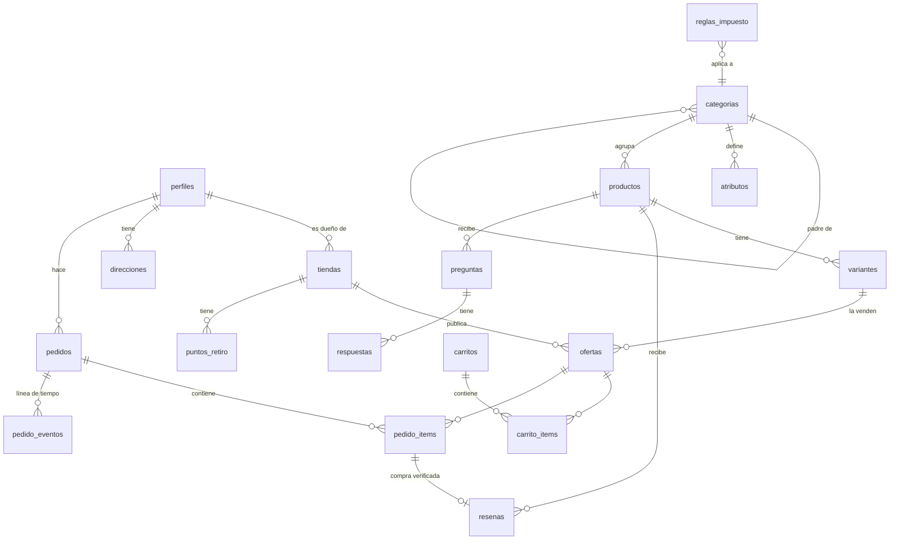

# Arquitectura

Stack: **Next.js (App Router) + TypeScript**, **Supabase** (PostgreSQL, Auth, Storage, RLS), **Stripe en modo de prueba**, **next-intl**, CSS Modules sobre los tokens de [`tokens/tokens.css`](../tokens/tokens.css), Vitest y Playwright. Deploy en Vercel con vista previa por rama.

## Reglas que no se negocian

1. **El precio lo calcula el servidor.** El navegador solo muestra. El monto que se cobra en Stripe sale de una Server Action que recalcula todo con las cotizaciones y reglas de impuesto vigentes.
2. **RLS en todas las tablas.** Ninguna tabla queda abierta "porque es de lectura".
3. **Plata en enteros.** Se guarda en la unidad mínima de cada moneda (`bigint`): guaraníes, centavos de real, centavos de dólar y pesos. Nada de `float` para dinero.
4. **El pedido congela todo:** título, precio, tasa de impuesto y cotización usada. Si mañana cambia la cotización, el pedido de ayer no cambia.

## Modelo de datos



### Tablas

| Tabla | Columnas principales | Notas |
| --- | --- | --- |
| `perfiles` | `id uuid` (= `auth.users.id`), `nombre`, `rol` (`comprador`/`vendedor`/`admin`), `region`, `idioma`, `moneda` | Se crea con un trigger al registrarse. |
| `tiendas` | `id`, `duenio_id`, `slug` único, `nombre`, `descripcion jsonb` (es/pt/en), `logo_url`, `portada_url`, `pais`, `ciudad`, `estado` (`pendiente`/`aprobada`/`suspendida`) | Un admin aprueba antes de publicar. |
| `categorias` | `id`, `padre_id`, `slug`, `nombre jsonb`, `orden` | Árbol: 16 principales y subcategorías. |
| `atributos` | `id`, `categoria_id`, `clave`, `tipo` (`texto`/`numero`/`booleano`/`opcion`), `unidad`, `opciones jsonb`, `filtrable`, `orden` | Lo que hace distinta una heladera de una remera: define la ficha técnica y los filtros. |
| `productos` | `id`, `slug`, `categoria_id`, `marca`, `titulo jsonb`, `vinetas jsonb`, `descripcion jsonb`, `atributos jsonb`, `peso_g`, `medidas_mm int[3]`, `garantia_meses`, `condicion`, `pais_origen`, `en_caja jsonb`, `busqueda tsvector` (generada) | `atributos` se valida contra `atributos` de la categoría con un trigger. |
| `variantes` | `id`, `producto_id`, `sku`, `opciones jsonb` (`{"color":"crema","capacidad_l":1.7}`), `imagenes text[]` | Cada variante tiene sus fotos. |
| `ofertas` | `id`, `variante_id`, `tienda_id`, `precio_base_usd_cent bigint`, `stock int`, `envio_gratis`, `plazo_preparacion_h`, `activa` | Único (`variante_id`, `tienda_id`): varios vendedores, un producto. |
| `cotizaciones` | `moneda`, `por_usd numeric(14,4)`, `fuente` (`cambio-cde`/`manual`), `vigente_desde` | Se lee la última por moneda. |
| `reglas_impuesto` | `pais`, `categoria_id` (nulo = general), `nombre` ("IVA", "Impuestos estimados"), `tasa numeric(5,4)`, `incluido_en_precio bool`, `desde`, `hasta` | **Simulación aproximada**, editable por el admin. |
| `zonas_envio` | `pais`, `ciudad`, `costo_base_usd_cent`, `costo_por_kg_usd_cent`, `dias_min`, `dias_max` | |
| `puntos_retiro` | `tienda_id`, `nombre`, `direccion`, `ubicacion point`, `horario jsonb` | Retiro en CDE con mapa. |
| `carritos` / `carrito_items` | `usuario_id` o `token_invitado`, `region`; `oferta_id`, `cantidad`, `para_despues bool` | Al iniciar sesión se fusionan (suma cantidades, respeta el stock). |
| `cupones` | `codigo`, `tipo` (`porcentaje`/`monto`), `valor`, `vence`, `usos_max`, `usos`, `solo_primera_compra` | |
| `direcciones` | `usuario_id`, `pais`, `campos jsonb`, `principal` | `campos` cambia por país: CEP en Brasil, código postal en Argentina, ciudad + barrio + referencias en Paraguay. Se valida con un esquema Zod por país. |
| `pedidos` | `comprador_id`, `region`, `moneda`, `cotizacion numeric`, `subtotal`, `impuestos jsonb`, `envio`, `descuento`, `total` (todo en unidad mínima), `estado`, `stripe_payment_intent` | Estados: `pendiente_pago` → `confirmado` → `preparando` → `enviado` → `entregado` (o `cancelado`, `devolucion`). |
| `pedido_items` | `pedido_id`, `oferta_id`, `tienda_id`, `titulo` (copia), `cantidad`, `precio_unitario`, `tasa_impuesto`, `impuesto` | Congelado al pagar. |
| `pedido_eventos` | `pedido_id`, `estado`, `nota`, `creado` | La línea de tiempo del pedido. |
| `resenas` | `producto_id`, `autor_id`, `pedido_item_id` (si existe: compra verificada), `estrellas 1..5`, `titulo`, `texto`, `fotos text[]`, `idioma`, `estado` (moderación), `util_si`, `util_no` | Una por compra. |
| `preguntas` / `respuestas` | `producto_id`, `autor_id`, `texto`, `estado`; `pregunta_id`, `autor_id`, `es_vendedor`, `texto` | |
| `listas` / `lista_items`, `alertas_precio` | | Favoritos, listas y alertas de baja de precio (simuladas en la fase 2). |
| `eventos` | `tipo` (`vista`, `agregar`, `compra`), `producto_id`, `tienda_id`, `sesion`, `creado` | Para las métricas del panel y la conversión. Particionada por mes. |

Vistas materializadas (se refrescan cada hora con `pg_cron`):
- `comprados_juntos (producto_a, producto_b, veces)`: coocurrencia en pedidos entregados.
- `reputacion_tiendas (tienda_id, recomendacion, ventas_12m, respuesta_media, a_tiempo)`.
- `resumen_resenas (producto_id, promedio, cantidad, distribucion int[5])`.

### Búsqueda

- Extensiones: `pg_trgm` y `unaccent` (con una función `inmutable_unaccent` para poder indexar).
- `productos.busqueda` es un `tsvector` generado con pesos: título (A) en los tres idiomas, marca (B), viñetas (C) y nombre de categoría (D), todo sin tildes.
- Índices:
  - `GIN (busqueda)` para texto completo.
  - `GIN (inmutable_unaccent(lower(titulo->>'es')) gin_trgm_ops)` (y `pt`, `en`) para tolerar errores.
  - `GIN (atributos jsonb_path_ops)` para filtros por atributo.
  - `btree (categoria_id)`, `btree (variante_id)` y un índice parcial `ofertas (variante_id) WHERE activa AND stock > 0`.
- Consulta: primero `websearch_to_tsquery('simple', unaccent(q))`. Si vuelven menos de 5 resultados, se completa con `word_similarity(q, titulo) > 0.35` ("iphnoe" → "iPhone", "cosina" → "cocina") y se muestra "Mostramos resultados para…".
- Facetas: una sola consulta con `GROUPING SETS` sobre marca, rango de precio, calificación y los atributos `filtrable` de la categoría, para que cada filtro muestre su contador.

### RLS (resumen)

| Tabla | Lectura | Escritura |
| --- | --- | --- |
| `productos`, `variantes`, `categorias`, `atributos` | Todos (`anon`) si el producto tiene al menos una oferta de una tienda aprobada | Dueño de la tienda (vía `ofertas`) o admin |
| `ofertas` | Todos, si `activa` y la tienda está aprobada | Solo el dueño de la tienda (`tiendas.duenio_id = auth.uid()`) |
| `tiendas` | Todos, si `aprobada` | El dueño edita sus datos; solo el admin cambia `estado` |
| `cotizaciones`, `reglas_impuesto`, `zonas_envio` | Todos | Solo admin (y la función programada que trae las cotizaciones de Cambio CDE, con la `service_role`) |
| `carritos`, `carrito_items`, `direcciones`, `listas` | Solo el dueño (`usuario_id = auth.uid()`); el invitado pasa por una Server Action con su token | Solo el dueño |
| `pedidos`, `pedido_items` | El comprador ve los suyos; el vendedor ve los ítems de su tienda; el admin, todo | **Nadie desde el cliente**: los crea el servidor al confirmar el pago (webhook de Stripe) |
| `pedido_eventos` | Comprador y vendedor del pedido | El vendedor agrega `preparando`/`enviado`; el sistema, el resto |
| `resenas` | Todos, si `estado = 'publicada'` | El autor crea la suya (solo si compró y no tiene otra); el admin modera |
| `preguntas`, `respuestas` | Todos, si publicadas | Cualquier usuario con cuenta; `es_vendedor` lo pone un trigger, no el cliente |
| `eventos` | Dueño de la tienda (agregados por su `tienda_id`) y admin | Inserción con una función `security definer` que limita la tasa |

Cada política se prueba en `supabase/tests/*.sql` con pgTAP: un usuario A no ve el carrito de B, un vendedor no edita la oferta de otro, nadie inserta un pedido desde el cliente.

## Precio, moneda e impuestos

Todo se guarda en **USD sin impuestos** (`precio_base_usd_cent`). El precio que ve el comprador se arma así:

```
precio_final = redondear( base_usd × (1 + tasa_impuesto(pais, categoria)) × cotizacion(moneda) , paso(moneda) )
```

| Moneda | Unidad mínima | Paso de redondeo en listados | Cómo se muestra |
| --- | --- | --- | --- |
| PYG | ₲ 1 | ₲ 1.000 | `₲ 234.000` |
| BRL | R$ 0,01 | R$ 0,10 | `R$ 197,60` |
| ARS | $ 1 | $ 100 | `$ 41.400` |
| USD | US$ 0,01 | US$ 0,01 | `US$ 31.90` |

Cotizaciones de ejemplo: 1 USD = ₲ 7.350 = R$ 5,45 = $ 1.180.

### Ejemplo 1: el mismo producto en los tres países (la "etiqueta de frontera")

Pava eléctrica, base **US$ 29,00** sin impuestos, categoría Cocina (tasa general):

| País | Impuesto | Con impuesto (USD) | Convertido | Precio final |
| --- | --- | --- | --- | --- |
| Paraguay | IVA 10 % | 29 × 1,10 = 31,90 | × 7.350 = 234.465 | **₲ 234.000** |
| Brasil | Estimado 25 % | 29 × 1,25 = 36,25 | × 5,45 = 197,5625 | **R$ 197,60** |
| Argentina | IVA 21 % | 29 × 1,21 = 35,09 | × 1.180 = 41.406,2 | **$ 41.400** |

Equivalencia en la moneda del comprador (para que la comparación sirva): `41.400 / 1.180 × 7.350 = 257.873 → ≈ ₲ 258.000`. Con este ejemplo, al paraguayo le conviene comprar en Paraguay, que es justamente lo que la etiqueta le deja ver en un toque.

### Ejemplo 2: desglose del checkout (Paraguay)

| Producto | Base USD | Tasa | Neto ₲ | Impuesto ₲ |
| --- | --- | --- | --- | --- |
| Pava eléctrica × 1 | 29,00 | 10 % | 213.150 | 21.315 |
| Juego de té × 1 | 48,00 | 10 % | 352.800 | 35.280 |
| Llave ajustable × 2 | 9,00 | 10 % | 132.300 | 13.230 |
| Medialunas × 1 | 4,20 | **5 %** (alimentos) | 30.870 | 1.543,5 |
| **Total** | | | **729.120** | 69.825 + 1.543,5 |

En pantalla, redondeado al paso de ₲ 1.000: productos ₲ 729.000, IVA 10 % ₲ 70.000, IVA 5 % ₲ 2.000, envío gratis, **total ₲ 801.000**.

- **Regla de redondeo:** se redondea cada renglón del desglose al paso de la moneda y el total es la suma de lo que se ve. Así la suma siempre cierra con lo que lee el comprador, y la diferencia contra el cálculo exacto (en este caso, ₲ 801.000 − ₲ 800.488,5 = ₲ 511,5) se registra en `pedidos.ajuste_redondeo`.
- Stripe recibe el total en la unidad mínima de la moneda: `801000` en PYG (moneda sin decimales en Stripe) o `19760` centavos en BRL.
- **Cuotas:** `ceil(total / cuotas)` al paso de la moneda (₲ 234.000 / 3 = **₲ 78.000**).
- **Envío:** `costo_base + costo_por_kg × peso`, en USD, convertido igual que los productos. Retiro en CDE = 0.
- **Cupones:** se aplican sobre el neto antes de impuestos (el impuesto se calcula sobre lo que efectivamente se cobra).

La lógica vive en un solo módulo puro, `lib/precios.ts` (`precioFinal`, `desglose`, `cuotas`), sin acceso a la base: recibe cotizaciones y reglas como parámetros. Así se prueba con Vitest con números exactos como los de arriba, y lo usan tanto los Server Components (listados) como la Server Action del pago.

## Carpetas (fase 1)

```
triplice/
├── app/
│   ├── [locale]/                 # es | pt | en (next-intl), URLs por idioma
│   │   ├── page.tsx              # inicio
│   │   ├── buscar/page.tsx
│   │   ├── p/[slug]/page.tsx     # ficha: estática con revalidación (ISR)
│   │   ├── tienda/[slug]/page.tsx
│   │   ├── carrito/page.tsx
│   │   ├── pagar/page.tsx        # checkout en pasos
│   │   ├── cuenta/…              # pedidos, direcciones, listas
│   │   ├── vender/…              # panel del vendedor
│   │   └── admin/…
│   ├── api/stripe/webhook/route.ts
│   └── sitemap.ts, robots.ts
├── components/                   # Tarjeta, EtiquetaFrontera, Filtros, Galeria, Desglose…
├── lib/
│   ├── precios.ts                # cálculo puro de precio, impuesto, cuotas y envío
│   ├── region.ts                 # detección y preferencia de región/moneda/idioma
│   ├── supabase/                 # clientes de servidor y navegador
│   └── validacion/               # esquemas Zod (direcciones por país, productos)
├── messages/es.json, pt.json, en.json
├── supabase/
│   ├── migrations/               # esquema, índices, RLS, vistas materializadas
│   ├── seed/                     # ~400 productos, 15 tiendas, reseñas y preguntas
│   └── tests/                    # pgTAP: políticas RLS
├── tokens/                       # tokens.css y marca.ts (ya en la fase 0)
├── e2e/                          # Playwright
└── docs/
```

## Plan de pruebas

| Capa | Herramienta | Qué cubre |
| --- | --- | --- |
| Lógica | **Vitest** | `lib/precios.ts` con los ejemplos de este documento (deben dar exacto), redondeo por moneda, impuesto reducido, cupones, cuotas, envío por peso; fusión del carrito de invitado con el de la cuenta; validación de direcciones por país (CEP de 8 dígitos, etc.). |
| Base | **pgTAP** (`supabase test db`) | Cada política RLS: lo que cada rol puede y no puede leer o escribir. Triggers de `atributos` y de `es_vendedor`. |
| Integración | Vitest + Supabase local | Búsqueda con errores de tipeo ("iphnoe", "cosina"), facetas con contadores, `comprados_juntos`. |
| Flujo completo | **Playwright** | Buscar → ficha → elegir variante → carrito → checkout con la tarjeta de prueba `4242…` → pedido confirmado con su línea de tiempo. Lo mismo en región Brasil (BRL). Tarjeta rechazada (`4000 0000 0000 0002`) con el mensaje de ayuda. Todo con teclado. |
| Accesibilidad | Playwright + axe-core | Cero violaciones serias en las 7 páginas principales. |
| Rendimiento | Lighthouse CI en cada PR | ≥ 95 en las cuatro categorías en inicio, búsqueda y ficha. |
