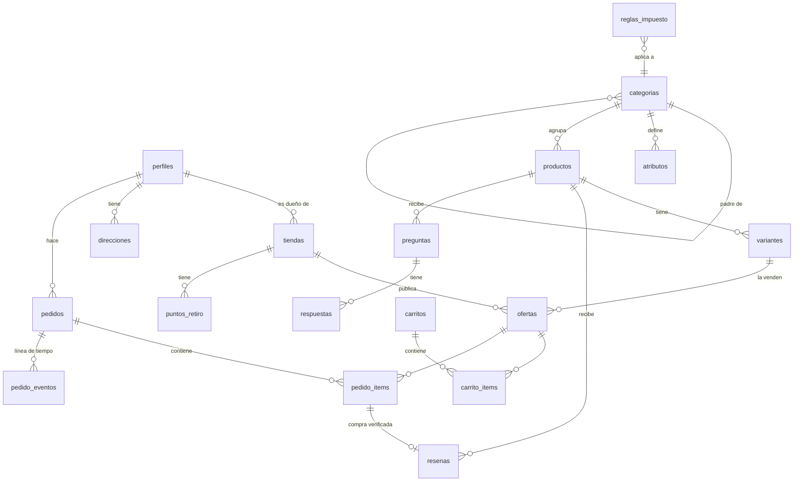

# Arquitectura

Stack: **Next.js (App Router) + TypeScript**, **Supabase** (PostgreSQL, Auth, Storage, RLS), **Stripe en modo de prueba**, **next-intl**, CSS Modules sobre los tokens de [`tokens/tokens.css`](../tokens/tokens.css), Vitest y Playwright. Deploy en Vercel con vista previa por rama.

## Reglas que no se negocian

1. **El precio lo calcula el servidor.** El navegador solo muestra. El monto que se cobra en Stripe sale de una Server Action que recalcula todo con las cotizaciones y reglas de impuesto vigentes.
2. **RLS en todas las tablas.** Ninguna tabla queda abierta "porque es de lectura".
3. **Plata en enteros.** Se guarda en la unidad mínima de cada moneda (`bigint`): guaraníes, centavos de real, centavos de dólar y pesos. Nada de `float` para dinero.
4. **El pedido congela todo:** título, precio, tasa de impuesto y cotización usada. Si mañana cambia la cotización, el pedido de ayer no cambia.

## Modelo de datos



### Tablas

| Tabla | Columnas principales | Notas |
| --- | --- | --- |
| `perfiles` | `id uuid` (= `auth.users.id`), `nombre`, `rol` (`comprador`/`vendedor`/`admin`), `region`, `idioma`, `moneda` | Se crea con un trigger al registrarse. |
| `tiendas` | `id`, `duenio_id`, `slug` único, `nombre`, `descripcion jsonb` (es/pt/en), `logo_url`, `portada_url`, `pais`, `ciudad`, `estado` (`pendiente`/`aprobada`/`suspendida`) | Un admin aprueba antes de publicar. |
| `categorias` | `id`, `padre_id`, `slug`, `nombre jsonb`, `orden` | Árbol: 16 principales y subcategorías. |
| `atributos` | `id`, `categoria_id`, `clave`, `tipo` (`texto`/`numero`/`booleano`/`opcion`), `unidad`, `opciones jsonb`, `filtrable`, `orden` | Lo que hace distinta una heladera de una remera: define la ficha técnica y los filtros. |
| `productos` | `id`, `slug`, `categoria_id`, `marca`, `titulo jsonb`, `vinetas jsonb`, `descripcion jsonb`, `atributos jsonb`, `peso_g`, `medidas_mm int[3]`, `garantia_meses`, `condicion`, `pais_origen`, `en_caja jsonb`, `busqueda tsvector` (generada) | `atributos` se valida contra `atributos` de la categoría con un trigger. |
| `variantes` | `id`, `producto_id`, `sku`, `opciones jsonb` (`{"color":"crema","capacidad_l":1.7}`), `imagenes text[]` | Cada variante tiene sus fotos. |
| `ofertas` | `id`, `variante_id`, `tienda_id`, `precio_base_usd_cent bigint`, `stock int`, `envio_gratis`, `plazo_preparacion_h`, `activa` | Único (`variante_id`, `tienda_id`): varios vendedores, un producto. |
| `cotizaciones` | `moneda`, `por_usd numeric(14,4)`, `fuente` (`cambio-cde`/`manual`), `vigente_desde` | Se lee la última por moneda. |
| `reglas_impuesto` | `pais`, `categoria_id` (nulo = general), `nombre` ("IVA", "Impuestos estimados"), `tasa numeric(5,4)`, `incluido_en_precio bool`, `desde`, `hasta` | **Simulación aproximada**, editable por el admin. |
| `zonas_envio` | `pais`, `ciudad`, `costo_base_usd_cent`, `costo_por_kg_usd_cent`, `dias_min`, `dias_max` | |
| `puntos_retiro` | `tienda_id`, `nombre`, `direccion`, `ubicacion point`, `horario jsonb` | Retiro en CDE con mapa. |
| `carritos` / `carrito_items` | `usuario_id` o `token_invitado`, `region`; `oferta_id`, `cantidad`, `para_despues bool` | Al iniciar sesión se fusionan (suma cantidades, respeta el stock). |
| `cupones` | `codigo`, `tipo` (`porcentaje`/`monto`), `valor`, `vence`, `usos_max`, `usos`, `solo_primera_compra` | |
| `direcciones` | `usuario_id`, `pais`, `campos jsonb`, `principal` | `campos` cambia por país: CEP en Brasil, código postal en Argentina, ciudad + barrio + referencias en Paraguay. Se valida con un esquema Zod por país. |
| `pedidos` | `comprador_id`, `region`, `moneda`, `cotizacion numeric`, `subtotal`, `impuestos jsonb`, `envio`, `descuento`, `total` (todo en unidad mínima), `estado`, `stripe_payment_intent` | Estados: `pendiente_pago` → `confirmado` → `preparando` → `enviado` → `entregado` (o `cancelado`, `devolucion`). |
| `pedido_items` | `pedido_id`, `oferta_id`, `tienda_id`, `titulo` (copia), `cantidad`, `precio_unitario`, `tasa_impuesto`, `impuesto` | Congelado al pagar. |
| `pedido_eventos` | `pedido_id`, `estado`, `nota`, `creado` | La línea de tiempo del pedido. |
| `resenas` | `producto_id`, `autor_id`, `pedido_item_id` (si existe: compra verificada), `estrellas 1..5`, `titulo`, `texto`, `fotos text[]`, `idioma`, `estado` (moderación), `util_si`, `util_no` | Una por compra. |
| `preguntas` / `respuestas` | `producto_id`, `autor_id`, `texto`, `estado`; `pregunta_id`, `autor_id`, `es_vendedor`, `texto` | |
| `listas` / `lista_items`, `alertas_precio` | | Favoritos, listas y alertas de baja de precio (simuladas en la fase 2). |
| `eventos` | `tipo` (`vista`, `agregar`, `compra`), `producto_id`, `tienda_id`, `sesion`, `creado` | Para las métricas del panel y la conversión. Particionada por mes. |

Vistas materializadas (se refrescan cada hora con `pg_cron`):
- `comprados_juntos (producto_a, producto_b, veces)`: coocurrencia en pedidos entregados.
- `reputacion_tiendas (tienda_id, recomendacion, ventas_12m, respuesta_media, a_tiempo)`.
- `resumen_resenas (producto_id, promedio, cantidad, distribucion int[5])`.

### Búsqueda

- Extensiones: `pg_trgm` y `unaccent` (con una función `inmutable_unaccent` para poder indexar).
- `productos.busqueda` es un `tsvector` generado con pesos: título (A) en los tres idiomas, marca (B), viñetas (C) y nombre de categoría (D), todo sin tildes.
- Índices:
  - `GIN (busqueda)` para texto completo.
  - `GIN (inmutable_unaccent(lower(titulo->>'es')) gin_trgm_ops)` (y `pt`, `en`) para tolerar errores.
  - `GIN (atributos jsonb_path_ops)` para filtros por atributo.
  - `btree (categoria_id)`, `btree (variante_id)` y un índice parcial `ofertas (variante_id) WHERE activa AND stock > 0`.
- Consulta: primero `websearch_to_tsquery('simple', unaccent(q))`. Si vuelven menos de 5 resultados, se completa con `word_similarity(q, titulo) > 0.35` ("iphnoe" → "iPhone", "cosina" → "cocina") y se muestra "Mostramos resultados para…".
- Facetas: una sola consulta con `GROUPING SETS` sobre marca, rango de precio, calificación y los atributos `filtrable` de la categoría, para que cada filtro muestre su contador.

### RLS (resumen)

| Tabla | Lectura | Escritura |
| --- | --- | --- |
| `productos`, `variantes`, `categorias`, `atributos` | Todos (`anon`) si el producto tiene al menos una oferta de una tienda aprobada | Dueño de la tienda (vía `ofertas`) o admin |
| `ofertas` | Todos, si `activa` y la tienda está aprobada | Solo el dueño de la tienda (`tiendas.duenio_id = auth.uid()`) |
| `tiendas` | Todos, si `aprobada` | El dueño edita sus datos; solo el admin cambia `estado` |
| `cotizaciones`, `reglas_impuesto`, `zonas_envio` | Todos | Solo admin (y la función programada que trae las cotizaciones de Cambio CDE, con la `service_role`) |
| `carritos`, `carrito_items`, `direcciones`, `listas` | Solo el dueño (`usuario_id = auth.uid()`); el invitado pasa por una Server Action con su token | Solo el dueño |
| `pedidos`, `pedido_items` | El comprador ve los suyos; el vendedor ve los ítems de su tienda; el admin, todo | **Nadie desde el cliente**: los crea el servidor al confirmar el pago (webhook de Stripe) |
| `pedido_eventos` | Comprador y vendedor del pedido | El vendedor agrega `preparando`/`enviado`; el sistema, el resto |
| `resenas` | Todos, si `estado = 'publicada'` | El autor crea la suya (solo si compró y no tiene otra); el admin modera |
| `preguntas`, `respuestas` | Todos, si publicadas | Cualquier usuario con cuenta; `es_vendedor` lo pone un trigger, no el cliente |
| `eventos` | Dueño de la tienda (agregados por su `tienda_id`) y admin | Inserción con una función `security definer` que limita la tasa |

Cada política se prueba en `supabase/tests/*.sql` con pgTAP: un usuario A no ve el carrito de B, un vendedor no edita la oferta de otro, nadie inserta un pedido desde el cliente.

## Precio, moneda e impuestos

Todo se guarda en **USD sin impuestos** (`precio_base_usd_cent`). El precio que ve el comprador se arma así:

```
precio_final = redondear( base_usd × (1 + tasa_impuesto(pais, categoria)) × cotizacion(moneda) , paso(moneda) )
```

| Moneda | Unidad mínima | Paso de redondeo en listados | Cómo se muestra |
| --- | --- | --- | --- |
| PYG | ₲ 1 | ₲ 1.000 | `₲ 234.000` |
| BRL | R$ 0,01 | R$ 0,10 | `R$ 197,60` |
| ARS | $ 1 | $ 100 | `$ 41.400` |
| USD | US$ 0,01 | US$ 0,01 | `US$ 31.90` |

Cotizaciones de ejemplo: 1 USD = ₲ 7.350 = R$ 5,45 = $ 1.180.

### Ejemplo 1: el mismo producto en los tres países (la "etiqueta de frontera")

Pava eléctrica, base **US$ 29,00** sin impuestos, categoría Cocina (tasa general):

| País | Impuesto | Con impuesto (USD) | Convertido | Precio final |
| --- | --- | --- | --- | --- |
| Paraguay | IVA 10 % | 29 × 1,10 = 31,90 | × 7.350 = 234.465 | **₲ 234.000** |
| Brasil | Estimado 25 % | 29 × 1,25 = 36,25 | × 5,45 = 197,5625 | **R$ 197,60** |
| Argentina | IVA 21 % | 29 × 1,21 = 35,09 | × 1.180 = 41.406,2 | **$ 41.400** |

Equivalencia en la moneda del comprador (para que la comparación sirva): `41.400 / 1.180 × 7.350 = 257.873 → ≈ ₲ 258.000`. Con este ejemplo, al paraguayo le conviene comprar en Paraguay, que es justamente lo que la etiqueta le deja ver en un toque.

### Ejemplo 2: desglose del checkout (Paraguay)

| Producto | Base USD | Tasa | Neto ₲ | Impuesto ₲ |
| --- | --- | --- | --- | --- |
| Pava eléctrica × 1 | 29,00 | 10 % | 213.150 | 21.315 |
| Juego de té × 1 | 48,00 | 10 % | 352.800 | 35.280 |
| Llave ajustable × 2 | 9,00 | 10 % | 132.300 | 13.230 |
| Medialunas × 1 | 4,20 | **5 %** (alimentos) | 30.870 | 1.543,5 |
| **Total** | | | **729.120** | 69.825 + 1.543,5 |

En pantalla, redondeado al paso de ₲ 1.000: productos ₲ 729.000, IVA 10 % ₲ 70.000, IVA 5 % ₲ 2.000, envío gratis, **total ₲ 801.000**.

- **Regla de redondeo:** se redondea cada renglón del desglose al paso de la moneda y el total es la suma de lo que se ve. Así la suma siempre cierra con lo que lee el comprador, y la diferencia contra el cálculo exacto (en este caso, ₲ 801.000 − ₲ 800.488,5 = ₲ 511,5) se registra en `pedidos.ajuste_redondeo`.
- Stripe recibe el total en la unidad mínima de la moneda: `801000` en PYG (moneda sin decimales en Stripe) o `19760` centavos en BRL.
- **Cuotas:** `ceil(total / cuotas)` al paso de la moneda (₲ 234.000 / 3 = **₲ 78.000**).
- **Envío:** `costo_base + costo_por_kg × peso`, en USD, convertido igual que los productos. Retiro en CDE = 0.
- **Cupones:** se aplican sobre el neto antes de impuestos (el impuesto se calcula sobre lo que efectivamente se cobra).

La lógica vive en un solo módulo puro, `lib/precios.ts` (`precioFinal`, `desglose`, `cuotas`), sin acceso a la base: recibe cotizaciones y reglas como parámetros. Así se prueba con Vitest con números exactos como los de arriba, y lo usan tanto los Server Components (listados) como la Server Action del pago.

## Carpetas (fase 1)

```
triplice/
├── app/
│   ├── [locale]/                 # es | pt | en (next-intl), URLs por idioma
│   │   ├── page.tsx              # inicio
│   │   ├── buscar/page.tsx
│   │   ├── p/[slug]/page.tsx     # ficha: estática con revalidación (ISR)
│   │   ├── tienda/[slug]/page.tsx
│   │   ├── carrito/page.tsx
│   │   ├── pagar/page.tsx        # checkout en pasos
│   │   ├── cuenta/…              # pedidos, direcciones, listas
│   │   ├── vender/…              # panel del vendedor
│   │   └── admin/…
│   ├── api/stripe/webhook/route.ts
│   └── sitemap.ts, robots.ts
├── components/                   # Tarjeta, EtiquetaFrontera, Filtros, Galeria, Desglose…
├── lib/
│   ├── precios.ts                # cálculo puro de precio, impuesto, cuotas y envío
│   ├── region.ts                 # detección y preferencia de región/moneda/idioma
│   ├── supabase/                 # clientes de servidor y navegador
│   └── validacion/               # esquemas Zod (direcciones por país, productos)
├── messages/es.json, pt.json, en.json
├── supabase/
│   ├── migrations/               # esquema, índices, RLS, vistas materializadas
│   ├── seed/                     # ~400 productos, 15 tiendas, reseñas y preguntas
│   └── tests/                    # pgTAP: políticas RLS
├── tokens/                       # tokens.css y marca.ts (ya en la fase 0)
├── e2e/                          # Playwright
└── docs/
```

## Plan de pruebas

| Capa | Herramienta | Qué cubre |
| --- | --- | --- |
| Lógica | **Vitest** | `lib/precios.ts` con los ejemplos de este documento (deben dar exacto), redondeo por moneda, impuesto reducido, cupones, cuotas, envío por peso; fusión del carrito de invitado con el de la cuenta; validación de direcciones por país (CEP de 8 dígitos, etc.). |
| Base | **pgTAP** (`supabase test db`) | Cada política RLS: lo que cada rol puede y no puede leer o escribir. Triggers de `atributos` y de `es_vendedor`. |
| Integración | Vitest + Supabase local | Búsqueda con errores de tipeo ("iphnoe", "cosina"), facetas con contadores, `comprados_juntos`. |
| Flujo completo | **Playwright** | Buscar → ficha → elegir variante → carrito → checkout con la tarjeta de prueba `4242…` → pedido confirmado con su línea de tiempo. Lo mismo en región Brasil (BRL). Tarjeta rechazada (`4000 0000 0000 0002`) con el mensaje de ayuda. Todo con teclado. |
| Accesibilidad | Playwright + axe-core | Cero violaciones serias en las 7 páginas principales. |
| Rendimiento | Lighthouse CI en cada PR | ≥ 95 en las cuatro categorías en inicio, búsqueda y ficha. |

## Fase 1: cómo quedó implementado (y qué cambió respecto del plan)

| Tema | Plan de la fase 0 | Lo que se hizo y por qué |
| --- | --- | --- |
| Datos | Supabase | Las **mismas migraciones** corren en Supabase y en **PGlite** (Postgres compilado a WebAssembly). Sin variables de Supabase, el servidor abre una copia embebida de la base (`.datos/triplice.tar.gz`, se arma en `prebuild`). Así la vista previa funciona antes de crear el proyecto y las pruebas usan Postgres de verdad, sin Docker. Ver [`supabase.md`](supabase.md). |
| Acceso | Server Actions y cliente de Supabase | La web solo llama funciones SQL (`buscar`, `sugerir`, `ficha`, `inicio`, `tienda`, `categorias_arbol`, `cotizaciones_vigentes`) con un único `jsonb` de entrada y salida, **como rol `anon`**: el RLS decide qué se ve en los dos modos (`lib/datos/fuente.ts`). |
| Tarjetas | Vista | **Vista materializada** `tarjetas` (precio mínimo con stock, tiendas distintas, promedio de reseñas). Calculado al vuelo bajo RLS costaba ~350 ms por búsqueda; leído de la vista, ~6 ms. Solo contiene lo público, así que no necesita RLS. Se refresca con `refrescar_catalogo()` (`security definer`, sin permiso para `anon`). |
| Búsqueda | `websearch_to_tsquery` + trigramas | Prefijos en todas las palabras (sirve para buscar mientras se escribe). Si no hay resultados, se corrige cada palabra con el **vocabulario del catálogo** (`ts_stat` sobre las tarjetas públicas: una palabra de un producto oculto nunca aparece como sugerencia) y, si tampoco, trigramas con umbral 0,4. La página avisa qué buscó. |
| Región y moneda | Selector en el encabezado | Cookie + **segmento interno** `/es/py-pyg/…` que agrega `proxy.ts`. La URL pública no cambia y cada combinación (3 idiomas × 4 regiones × 4 monedas) se cachea por separado: el precio sale del servidor ya convertido, sin parpadeo. |
| Caché | ISR | Next.js 16 con **Cache Components**: consultas con `'use cache'` y `cacheLife`; layout y fichas prearmados; búsqueda y categorías con prerender parcial (la parte que depende de los filtros llega en streaming). Idioma y mercado se leen con `next/root-params`, nunca con `headers()`. |
| Impuestos | En la fase 1 | Quedan para la fase 2, como dice el plan de fases: los precios se muestran **sin impuestos** y la ficha muestra la equivalencia en las otras tres monedas. |

Pruebas de esta fase:
- **Vitest** sobre PGlite: búsqueda con errores, acentos y en tres idiomas; facetas que suman; ficha; RLS (un producto de una tienda pendiente no aparece ni en la búsqueda ni en las sugerencias).
- **Vitest** de `lib/precios.ts` y `lib/busqueda.ts`: conversión, redondeo por moneda, montos con los separadores de cada país.
- **Playwright** (`e2e/`) contra el build de producción, en escritorio y celular.

## Fase 2: cómo quedó implementado

| Tema | Plan | Lo que se hizo y por qué |
| --- | --- | --- |
| Impuestos | `reglas_impuesto` por país y categoría | Igual, con la regla más específica primero (subcategoría → categoría → general). **Los precios llevan el impuesto incluido** en Paraguay, Brasil y Argentina (es lo que se acostumbra en la región) y en "Internacional" no hay impuestos locales. La web aplica la tasa con `lib/compra/impuestos.ts` sobre la categoría que trae cada tarjeta; la búsqueda filtra y ordena con el mismo precio (`tasa_impuesto` en SQL). |
| Redondeo | Cada renglón al paso de la moneda, total = suma de lo que se ve | Igual. Como el precio ya incluye el impuesto, el desglose **informa** el impuesto incluido ("Incluye IVA 10 %: ₲ 70.000"), calculado sobre lo que se cobra después del cupón. Así el total del carrito es la suma de los precios que el comprador vio en las tarjetas. |
| Carrito | `carritos` con usuario o token de invitado | El de **invitado vive en una cookie** (solo ids de oferta y cantidades; precios, stock e impuestos se leen de la base cada vez). La vista previa sin Supabase abre una copia de la base por instancia: guardar el carrito ahí se perdería entre pedidos. El de la cuenta está en `carritos`/`carrito_items` con RLS y `fusionar_carrito` (misma regla que `fusionar()` en TypeScript) para la fase 3. |
| Envío | `zonas_envio` por región y peso | Zona de la frontera (más barata y rápida) y resto del país, por kilo cobrable (al medio kilo, como las transportadoras), **por tienda**: cada vendedor despacha lo suyo y el envío gratis de una tienda no regala el de otra. |
| Retiro | Puntos de retiro con mapa | `puntos_retiro` (el local de cada tienda). El mapa es un SVG propio de la triple frontera con los locales numerados igual que la lista: sin mosaicos de terceros (ni cookies ni peticiones a otro servidor). |
| Pago | Server Action + Stripe | Stripe Checkout **solo en modo de prueba** (una clave `sk_live_` se rechaza), en la moneda de la región, con un solo renglón por el total calculado en el servidor. Si el total que vio el comprador no es el que se va a cobrar, se avisa. Sin claves, un **simulador de prueba** (no pide datos de tarjeta) permite recorrer el flujo. |
| Pedidos | Los crea el webhook | `registrar_pedido` (al pagar, todo congelado, estado `pendiente_pago`) y `confirmar_pago` (descuenta stock, cuenta el cupón, idempotente), las dos solo con el rol de servicio. Confirman el webhook (con firma) y la vuelta de Stripe (verifica con la API). El comprobante se guarda además en una **cookie firmada** (HMAC): sin Supabase, es lo que permite mostrarlo aunque el pago se confirme en otra instancia. |
| Rendimiento | | next-intl solo en el servidor (en el navegador, `lib/i18n/formato.ts`, probado contra next-intl), fotos de las vidrieras pedidas al acercarse (`FotoDiferida`) y fuentes recortadas al rango de pesos que se usa. |

## Fase 3: cómo quedó implementado

| Tema | Plan | Lo que se hizo y por qué |
| --- | --- | --- |
| Auth | Supabase Auth, email y Google | Con Supabase: **enlace por email** (sin contraseñas que guardar) y **Google**, con `@supabase/ssr`. La sesión vive en cookies, `proxy.ts` la renueva solo si hay una cookie `sb-…` (los visitantes sin cuenta no consultan Auth en cada página) y la vuelta es `/api/auth/callback`. Sin Supabase, la vista previa ofrece una **cuenta de prueba** (Lorena, de Hernandarias) con sesión en una cookie firmada (HMAC). En los dos modos las funciones de la cuenta corren **como el usuario**: con Supabase, por el cliente con su JWT; en PGlite, con `set local role authenticated` y `request.jwt.claim.sub`, que es lo que lee `auth.uid()`. El SQL y el RLS son los mismos (`lib/cuenta/sesion.ts`). |
| Perfil | `perfiles` | Se crea con un disparador al registrarse (nombre de Google o la parte del email). Se firma "Lorena B." en opiniones y preguntas (`firma()`), nunca con el apellido ni el correo. Región, moneda e idioma del perfil se aplican al entrar. |
| Encabezado | | Sigue estático y cacheado: "Hola, Lorena" sale de una cookie sin nada privado que lee el navegador (igual que el contador del carrito). La sesión real la verifica el servidor en cada página de la cuenta. En el celular, la cuenta está en el menú ☰. |
| Direcciones | `direcciones` con RLS | Hasta 10, una predeterminada (índice único parcial). Los campos por país se validan con el mismo `validarDatos` del pago. Al pagar con sesión, las del país aparecen para elegir y los datos del perfil vienen completos; el pedido se registra con `comprador_id`. |
| Pedidos | Línea de tiempo | `mis_pedidos` y `mi_pedido` (security invoker: el RLS decide). El trayecto de cuatro paradas con la fecha de cada una sale de `pedido_eventos` (`lib/cuenta/pedidos.ts`, probado). |
| Devoluciones | Solicitud | `solicitar_devolucion` (security definer, porque además escribe el evento en la línea de tiempo): el ítem tiene que ser del usuario, estar entregado y dentro de **7 días**, y uno por ítem. Motivo, reembolso o cambio, y detalle. |
| Comprobante | PDF simulado | `pdf-lib` en una ruta del servidor, con las fuentes de la marca (instancias TTF estáticas que arma `herramientas/fuentes-pdf.py`: fontkit no recorta fuentes variables). Los montos van con **"Gs."** como en las facturas de Paraguay (las fuentes no tienen ₲). Lo baja el dueño del pedido con su cuenta o el invitado con la cookie firmada; dice en la cabecera que no tiene valor fiscal. |
| Opiniones | Solo compra verificada, con fotos | La política de inserción exige un `pedido_item` propio y entregado; un disparador pone autor, firma, país, variante, sello y contadores (el cliente no los elige). Una por persona y producto. Fotos: hasta 4, el servidor las achica a 1200 px, saca el EXIF (ubicación) y las pasa a WebP; con Supabase van a Storage (`resenas/<uid>/…`, política por carpeta), sin Supabase a la memoria del servidor. En la ficha, las que tienen fotos van primero. |
| Votos | "Me fue útil" | `votos_resena` con RLS (uno por persona, nunca a la propia); un disparador **suma y resta** los contadores (las opiniones del seed traen sus votos). El botón se actualiza sin recargar. |
| Preguntas | Comprador y vendedor | Cualquiera con cuenta pregunta o responde; la base marca si responde **la tienda** que lo vende o un comprador que **lo recibió**, y limita 5 preguntas y 10 respuestas por hora. |
| Ficha cacheada | | Lo personal (mis votos, si puedo opinar) lo pide el navegador después de cargar con una Server Action: la ficha sigue prearmada igual para todos. Opinar, votar y preguntar invalidan su caché con `updateTag('producto:…')`. |

## Fase 4: panel del vendedor — cómo quedó implementado

| Tema | Plan | Lo que se hizo y por qué |
| --- | --- | --- |
| Quién vende | `tiendas.duenio_id` y rol `vendedor` | Ya estaba en el esquema. El panel exige las dos cosas (`mi_tienda()`: dueño de una tienda **y** perfil `vendedor` o `admin`); un comprador que entra a `/vender` ve qué es la sección y, en la vista previa, un botón para probarla. Sin Supabase hay un **vendedor de prueba** (Rubén Ayala, dueño de Casa Nubla) que entra desde `/entrar`, con sesión en la misma cookie firmada que la cuenta de Lorena. Con Supabase se le da la tienda a una cuenta con dos `update` ([`supabase.md`](supabase.md)). |
| Productos de varias tiendas | Escritura del dueño "vía ofertas" | Nueva columna `productos.tienda_id`: la tienda que **publicó** el producto es la única que edita nombre, ficha técnica, fotos y variantes; las demás que lo venden cambian solo su oferta (precio, stock, pausa). Las variantes que vende otra tienda nunca se borran (solo se pausa mi oferta), porque el borrado en cascada se saltearía el RLS ajeno. |
| Alta y edición | Formulario con variantes | `guardar_producto` (security invoker) recibe un `jsonb` con el producto, los ejes de variación (color, memoria, talle, medida, contenido) y cada variante con su precio en **centavos de dólar sin impuestos**, stock y fotos; crea el slug (sin tildes, único) y el SKU. La Server Action valida antes con `lib/vender/producto.ts` (módulo puro, probado) y cada error vuelve atado a su campo con un mensaje que dice cómo resolverlo; la base valida lo mismo, y un disparador revisa que los atributos sean de la categoría y del tipo correcto. El formulario muestra el precio final en los tres países con el mismo cálculo de impuestos que la tienda. |
| Fotos | Storage por carpeta de la tienda | Igual que las de las opiniones: el navegador las achica a 1600 px antes de mandarlas (de un celular no viajan 10 MB), y el servidor las achica a 1200 px, les saca el EXIF y las pasa a WebP, además en los tres anchos del catálogo (240/480/800) para que la tarjeta y la ficha las pidan igual que las demás. Con Supabase van al bucket `productos/<tienda>/…` (política por carpeta); sin Supabase, a la memoria del servidor (la página lo avisa). El id en la base es `subida:<tienda>/<archivo>` y `foto()` lo traduce. |
| Métricas | KPIs y gráfico | `vendedor_resumen` calcula en SQL las ventas de los últimos 30 días (monto, pedidos, unidades, ticket promedio y el período anterior para comparar), la serie por día con los días sin ventas en cero (`generate_series`, en hora de Asunción), lo más vendido, los pedidos por preparar con el plazo más cercano, las preguntas sin responder y lo que tiene poco stock. Cada renglón se pasa de la moneda en que se cobró, con su **cotización congelada**, a la moneda del mercado con la de hoy (`a_moneda`); si es la misma moneda no se toca, así las sumas son exactas. |
| Gráfico | Sin librerías | SVG armado en el servidor (`GraficoVentas`): barras por día, el mejor día en lapacho con su monto y una línea punteada con el promedio diario de los 30 días anteriores. En el celular, los últimos 14 días. Sin JavaScript: el detalle de cada barra va en su `<title>` y la tabla completa en un `<details>`. |
| Reputación | Vista materializada `reputacion_tiendas` | La tabla cargada a mano de la fase 1 se reemplazó por la vista materializada `reputacion_calculo` con cinco factores de 0 a 100: opiniones con 4 o 5 estrellas (35 %), pedidos que llegaron dentro del plazo prometido — horas de preparación congeladas en `pedido_items.preparacion_h` + días máximos de envío — (30 %), productos sin devolución (15 %), preguntas respondidas (10 %) y la mediana del tiempo de respuesta (10 %); un factor sin datos no cuenta y su peso se reparte. `reputacion_tiendas` quedó como **vista pública con las mismas columnas** (`recomendacion` = la reputación calculada), así la ficha, el inicio y la página de la tienda no cambiaron de código. El panel muestra cada factor, de dónde sale, su peso y cuánto aporta, y qué factor conviene mejorar. Se refresca al avanzar un pedido o responder, y con `refrescar_catalogo()` (en Supabase, con pg_cron cada hora). |
| Datos para medir | Seed | El seed suma un historial de 12 meses (~6.000 pedidos de 45 compradores ficticios, con su línea de tiempo, algunos atrasados, cancelados y devueltos), armado en SQL con semilla fija y fechas relativas al momento de cargarlo. En PGlite las fechas se corren al día al abrir la base. Al final del seed corre `analyze`: sin estadísticas, el planificador armaba las tarjetas en 4 s en vez de 0,2 s. |
| Pedidos | El vendedor marca preparando/enviado | Cada tienda avanza **su parte**: `avanzar_pedido` inserta en `pedido_eventos` con `tienda_id` (política de inserción solo para el dueño, solo esos estados). Un disparador valida el orden (no se prepara dos veces ni se vuelve atrás) y guarda "listo para retirar" si es retiro; otro avanza el pedido cuando **todas** sus tiendas llegaron a esa etapa. Es lo que el comprador ve en el trayecto de su pedido (fase 3). |
| Preguntas | Responder | `vendedor_preguntas` lista las de lo que vendo, sin responder primero (las de los últimos 90 días que ninguna tienda respondió). `vendedor_responder` verifica que la pregunta sea de un producto mío; el sello de vendedor y el nombre de la tienda los pone el disparador de la fase 3 (con un límite de 120 respuestas por hora para tiendas). |
| Caché | `updateTag` | Guardar un producto, su stock o pausarlo invalida `producto:<slug>`, `tienda:<slug>` y `catalogo`; responder, `producto:<slug>`. Las tarjetas (vista materializada) se refrescan dentro de la misma función SQL con `vendedor_refrescar` (security definer, con el chequeo de que quien llama tiene tienda). |
| RLS | Cada tienda ve lo suyo | Probado en Vitest contra PGlite: otra tienda no lee ni edita productos, ofertas, variantes, pedidos ni preguntas (ni con funciones ni escribiendo directo en las tablas), no publica a nombre de otra, un comprador no escribe en la línea de tiempo y sin cuenta las funciones ni se pueden llamar. Las políticas de lectura de ítems y eventos se reordenaron para que lo de mi tienda se resuelva primero (la lista de pedidos pasó de 0,9 s a 0,04 s). |

Pruebas de esta fase:
- **Vitest** (`tests/vendedor.test.ts`): métricas con números exactos sobre pedidos armados a mano (₲ 621.000 en 3 pedidos, ticket ₲ 207.000; en dólares, 8.449 centavos), la reputación factor por factor (66,3 %), alta y edición con variantes, validaciones, pausa, stock rápido, el pedido que avanza por tienda y el RLS.
- **Playwright** (`e2e/vender.spec.ts`), en escritorio y celular: un comprador no entra; el vendedor ve las métricas, publica un producto con dos variantes y una foto, lo ve en la ficha con su precio, responde una pregunta y despacha un pedido.
- **Lighthouse** del resumen del panel (build local, con la sesión del vendedor de prueba): celular 93 · 100 · 100 · 66 y escritorio 100 · 100 · 100 · 66 (rendimiento, accesibilidad, buenas prácticas y SEO). El SEO baja solo por el `noindex`, que es a propósito: el panel es privado.

## Fase 5: descubrimiento — cómo quedó implementado

| Tema | Plan | Lo que se hizo y por qué |
| --- | --- | --- |
| Comparador | Hasta 4 de la misma categoría, lado a lado | `/comparar?p=slug1,slug2…` se arma **en el servidor** con la función `comparar` (precio de la tarjeta, la tienda de la mejor oferta con su reputación, opiniones y los atributos de la subcategoría y su principal). Mezcla solo **categorías hermanas** (mismo padre): la familia la define el primero y los demás quedan afuera con un aviso. La lista vive en una cookie (`slug~familia`) que escribe el navegador al tocar «Comparar» en la tarjeta o la ficha (no recarga la página) y que lee el servidor; sin `?p` la página redirige a la de la cookie, así la dirección siempre se puede compartir. Con cuenta, lo mismo. |
| La idea fuerte | Las diferencias | `lib/descubrir/comparar.ts` alinea los atributos (módulo puro, probado): lo que es **igual en todos** se junta en una sola celda apagada ("igual en los 3"); lo que **cambia** queda en su columna con una raya lapacho y, si es un número, una barra proporcional. El precio más bajo y la reputación más alta llevan su sello. «Solo lo que cambia» es un enlace (`&solo=1`): funciona sin JavaScript. |
| Comparador en el celular | Columnas o tarjetas apiladas | Tabla real (los lectores de pantalla la recorren como tabla) con **la primera columna pegada** y desplazamiento horizontal: en 390 px se ven el nombre del dato y una columna y media, que invita a deslizar. Las tarjetas apiladas por atributo obligaban a leer arriba-abajo para comparar dos números. |
| Vistos recientemente | Últimos ~12 | Sin cuenta, cookie (`triplice_vistos`, la escribe el navegador); con cuenta, tabla `vistos` (los 12 últimos, recortados en la base). Al entrar se suman los de la cookie y la cookie se borra, como el carrito. En el inicio y al pie de la ficha es una **isla** que se pide con `requestIdleCallback` después de cargar: la ficha sigue prearmada igual para todos y, sin cookie ni sesión (lo que mide Lighthouse), no pide nada ni ocupa lugar. |
| Comprados juntos | Vista materializada por coocurrencia | `comprados_juntos (producto_a, producto_b, veces)`: pedidos distintos (no unidades) que no quedaron sin pagar ni se cancelaron, en las dos direcciones, **mínimo 3**. Se rehace con `refrescar_catalogo()` (la versión anterior se renombró y la nueva la llama). Si no hay datos, lo más vendido de las **categorías hermanas** (la misma subcategoría ya sale en "relacionados"). En la ficha: el producto + el que más se llevó con él, el total con impuestos calculado en el servidor y «Agregar los dos al carrito», que recibe **slugs**: la base elige la oferta más barata con stock y el carrito recalcula todo. El historial del seed tenía un producto por pedido; se sumaron 640 "canastas" de pares que se compran juntos en la frontera. |
| Listas y favoritos | Con cuenta | Favoritos es una lista más (`favoritos = true`, una por persona, no se borra ni se renombra). Listas con nombre, crear, renombrar, mover y sacar productos, borrar. Límites en la base: 20 listas, 100 productos por lista, 60 caracteres, nombre único. El corazón (botón con `aria-pressed`) está en la tarjeta y en la ficha: sin cuenta guarda la intención en una cookie y lleva a entrar; al volver, el favorito ya está guardado. |
| Lista compartida | Enlace de solo lectura | Token de 64 hex (244 bits) que genera la base aunque se mande otro; revocar = nulo, compartir de nuevo da otro. `/lista/<token>` lo lee con `lista_compartida` (security definer, lo mínimo: nombre, firma "Lorena B." y productos públicos), `noindex` y sin `Referer`. |
| Alertas de precio | Simuladas | «Avisame si baja de X» en la ficha, en la moneda del mercado. La base guarda el objetivo **en esa moneda** (unidad mínima), la región (el impuesto), el precio de ese momento y el **base en USD sin impuestos**. Se cumple cuando el precio final de hoy **en esa moneda y con la cotización de hoy** (`precio_final`, el mismo cálculo que `lib/compra/impuestos.ts`) llega al objetivo: si el dólar sube, un precio en guaraníes puede bajar sin que la tienda toque nada. Las revisa `revisar_alertas` al entrar y al abrir la cuenta (en Supabase, además, pg_cron cada 30 minutos con `revisar_alertas_todas`). El disparador recalcula y decide: no se marca cumplida a mano y no se cumple dos veces. El aviso queda en la cuenta ("Bajó el precio de …: ahora ₲ …") y un número lapacho en el ícono de la cuenta del encabezado; la página dice que es una simulación sin correos. |
| Encabezado | Estático | Sigue cacheado igual para todos: el número de avisos y los corazones marcados se piden una vez por página con una Server Action de solo lectura (`estadoAccion`), y solo si hay sesión. |
| Sin JavaScript | Formularios | El corazón, «Comparar», «Agregar los dos», crear lista, mover, compartir, la alerta y «Solo lo que cambia» son formularios o enlaces comunes; con JavaScript, los botones no recargan. |

Pruebas de esta fase:
- **Vitest** (`tests/descubrimiento.test.ts`, contra PGlite con los permisos de Supabase): otro usuario y un anónimo no leen ni tocan listas, favoritos, vistos ni alertas ajenas (ni con funciones ni escribiendo directo); el token lo genera la base, funciona sin sesión y deja de funcionar al revocarlo; "comprados juntos" con números exactos sobre pedidos armados a mano (3 pedidos ⇒ par; 2 con uno cancelado ⇒ no; uno pendiente no cuenta); la alerta se cumple al bajar el precio, una sola vez, en reales con la cotización del día; el comparador alinea atributos; límites de listas e ítems; cookies y montos.
- **Playwright** (`e2e/descubrimiento.spec.ts`, escritorio y celular): comparar 3 celulares y ver solo lo que cambia; el corazón sin cuenta pide entrar y vuelve; crear una lista, compartirla y abrirla sin sesión, y que deje de funcionar; vistos en el inicio y al pie de la ficha; "comprados juntos" al carrito; la alerta cumplida de Lorena.
